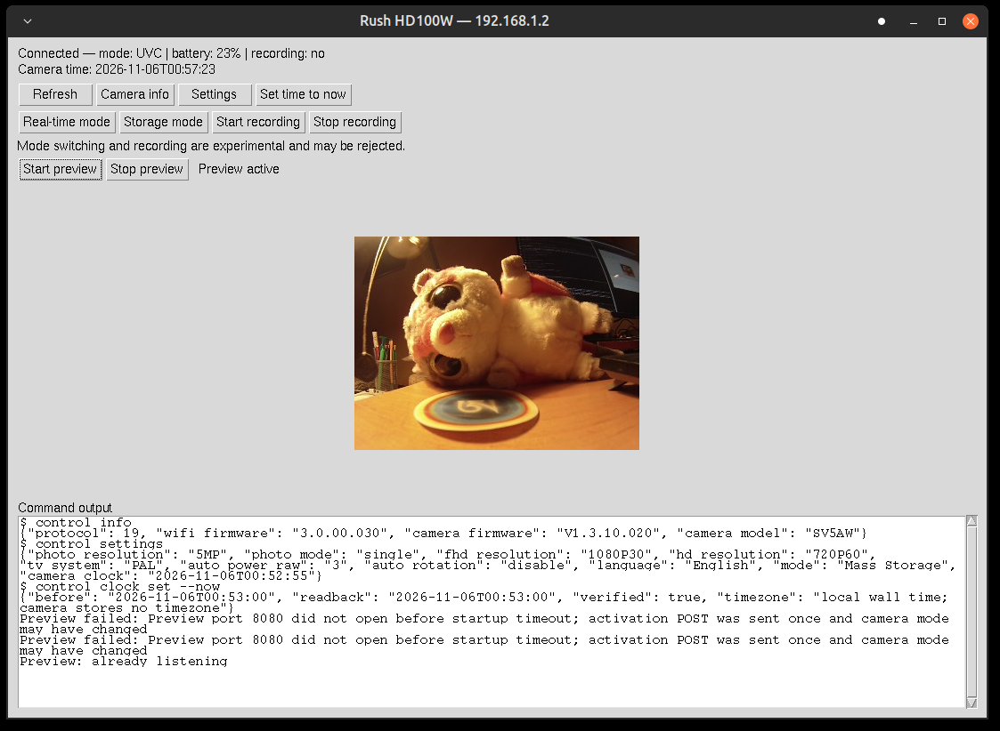

# Rush HD100W tools

Independent Linux-first tooling for the Kitvision Rush HD100W action camera.
Python 3.15 prototypes can inspect services, activate preview, capture JPEGs and
publish the preview as a Linux virtual webcam, inspect camera status and set
the recording clock. Recording start/stop commands are implemented but currently
rejected by this camera; successful SD recording remains unresolved.

## Why this project exists

The Rush HD100W still works as an action camera, but its original desktop
software targets older Windows and macOS systems, and its withdrawn Android
app no longer works on modern Android devices. Without a display on the camera,
even correcting a drifting recording clock depends on external software.

This project documents the camera's interfaces and builds independent tools so
owners can keep using their hardware on current systems. It starts on Linux,
with the longer-term aim of making control available on other platforms. By
restoring useful features and sharing the findings, it aims to extend the
camera's life and reduce electronic waste.

The tools are experimental: clock setting and preview have been tested on one
camera, while reliable mode switching, recording control and clock persistence
still need investigation. See the [task ledger](PLANS.md) for remaining work.

## Quick start

Connect the host to the camera hotspot, keeping that Wi-Fi connection LAN-only
if internet access is available through Ethernet. The default camera address is
192.168.1.2. Read [network exposure notes](docs/security.md) before use on
a shared network: known shell credentials, empty-password FTP and
unauthenticated HTTP access expose substantial camera functionality.

```sh
uv sync --python 3.15
uv run python tools/gui.py
uv run python tools/rush.py inspect
uv run python tools/control.py status
uv run python tools/control.py clock set --now --dry-run
uv run python tools/rush.py snapshot --activate tmp/snapshot.jpg
uv run python tools/webcam.py
```

The experimental Tkinter window shows camera status and time, offers control
commands and displays live preview. It requires a graphical desktop and Python
with Tkinter installed. Preview activation changes camera mode. Mode switching
and recording can still be rejected; errors appear in the output box.



Create `tmp/` if absent before saving a snapshot. Capture output paths must not
already exist. Snapshot without `--activate` only reads an active preview;
`preview-start` activates it without saving an image. Use `--host` and
`--timeout` before rush.py's subcommand to override defaults. Startup waits
up to 20 seconds; the old CGI can time out even when activation succeeds.

Webcam mode needs FFmpeg, v4l-utils and v4l2loopback. By default it allocates a
new camera and cleans up its own device on exit. Dynamic allocation requires a
recent loopback driver and control utility. An explicitly selected, verified
existing loopback works with older drivers:

```sh
uv run python tools/webcam.py --device /dev/video0 --fps 5
```

Snapshot polling is now the default transport to tolerate the camera’s flaky
multipart endpoint; `--source stream` selects the original direct stream.

Do not assume video0 is unused or virtual on another computer. See the
[webcam guide](docs/virtual-webcam.md) for setup, permissions, MJPEG/YUYV options,
cleanup and hardware test limits. Preview stays enabled after exit; concurrent
SD recording compatibility is unverified. No audio stream is provided.

## Documentation and research

- [Documentation index](docs/README.md): hardware, protocols and experiments.
- [Recording clock and camera control](docs/control-tool.md).
- [Architecture and Python/Rust assessment](docs/architecture.md).
- [Task ledger](PLANS.md): verified milestones and unresolved work.

Offline helpers never execute vendor binaries:

```sh
uv run python tools/inventory.py
uv run python tools/apk-inspect.py
uv run python tools/mips-analyze.py tmp/camera/rootfs/bin/remote tmp/remote
```

The last command requires llvm-objdump-14 and a previously captured binary.
Keep generated listings and ELF copies under tmp/. Raw dumps are not included
in this repository. Their manifest and reproducible findings live in docs/.

## Development

The code is developed with the assistance of GPT Codex.

Python 3.15+ with uv and a project-local environment. Pillow provides JPEG
display in the GUI; development tools and dependencies are locked in uv.lock.

```sh
uv run python -m unittest discover -s tests -v
uv run ruff check tools tests
uv run ruff format --check tools tests
uv run ty check tools
markdownlint-cli2 '*.md' 'docs/**/*.md'
```

## Repository contents and license

Project-authored code/documentation use EUPL-1.2; see LICENSE. Proprietary
reference apps and third-party materials are not covered by that grant.

apps/ stores ignored reference binaries; media/ stores ignored personal samples;
tmp/ stores ignored firmware copies, diagnostics and temporary outputs. captures/
is also ignored for personal recordings. Do not commit raw camera data, dumped
configuration, vendor graphics or decompiled source. Keep portable, independently
written protocol notes and sanitized test fixtures instead.
