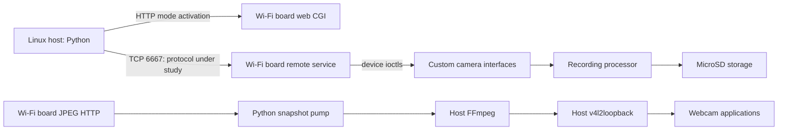

# System architecture and implementation direction

## Evidence-backed model

The Wi-Fi subsystem runs MIPS Linux with about 13.5 MiB visible RAM and a
read-only squashfs root. Its version and system clock differ from the camera
firmware and EXIF clock. The exact internal physical control transport is still
an inference; a custom USB driver and distinct USB IDs support that model.
Do not treat a Linux `date -s` operation as a verified recording-clock change.

## Python is sufficient for the current application

- Network I/O, protocol messages, diagnostics and process management use the
  Python standard library. Pillow decodes JPEG frames for the Tkinter GUI.
- Video already flows through FFmpeg in native code. MJPEG passthrough copies
  compressed frames; Python does not decode or re-encode every pixel.
- Linux device creation belongs to v4l2loopback. A new custom kernel driver
  would add maintenance without addressing a demonstrated missing capability.
- uv pins the environment; Ruff and ty validate source. Mocked hardware tests
  permit iteration when the camera is disconnected.
- Keep verified protocol operations separate from command-line presentation
  as the project grows. Do not create a generic transport framework prematurely.

Continue in Python while recording behavior and clock persistence are
validated. Direct clock operations are already working. No Rust rewrite or
Rust crates are needed now. Rust becomes worth
reconsidering for a concrete deployment need (a small standalone executable),
a measured performance bottleneck outside FFmpeg, or an agreed cross-platform
UI/integration design. Those are future evaluations, not current requirements.
Native Kotlin remains a possible later Android client consuming the written
protocol specification. No Android or foreign-desktop builds are implemented.

## Current interfaces

- `tools/rush.py`: inspect services, activate preview, save one JPEG.
- `tools/control.py` and `tools/protocol.py`: identity, authenticated status,
  read-only settings and verified clock writes; experimental recording control.
- `tools/gui.py`: Tkinter interface with background control and JPEG preview.
- `tools/webcam.py`: allocate a new virtual camera by default, activate preview,
  and supervise FFmpeg; explicit existing-device mode supports older drivers.
- `tools/inventory.py`, `tools/apk-inspect.py`, `tools/mips-analyze.py`: offline
  analysis helpers; they do not execute vendor binaries.
- Raw analysis artifacts and personal media are ignored, specifications and
  authored helpers are publishable under the project license.

## Remaining uncertainties

- Recording rejection 0x8d and camera SPI timeouts despite verified login.
  Framing, checksum, identity, status and direct clock writes now work.
- Recording-clock persistence after power loss and timestamps in new media;
  direct clock read/write and within-one-second readback are verified.
- Preview compatibility with recording and SD/USB storage modes.
- Repeatable SD-backed external USB disconnection after roughly six seconds.
- Dynamic virtual-camera allocation on a recent loopback driver; this host's
  bundled legacy module lacks its control device. Existing-device MJPEG output
  and readback were verified, but automatic allocation is not hardware-verified.
